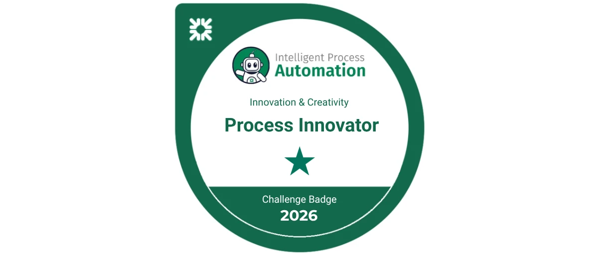

# Manvith Reddy Dalli

### Enterprise automation · Data engineering · Applied AI

I turn complex problems into practical solutions—using automation, data, and AI to make everyday work smarter. My work spans enterprise automation, data engineering, and applied AI—from streamlining banking workflows at Citizens to building options risk analytics and generative models.

**[Explore the portfolio →](https://manvith-d.github.io/portfolio/)** · [LinkedIn](https://www.linkedin.com/in/manvith-reddy-dalli-38a06a257) · [Résumé](resume.pdf)

## Citizens Bank — Automation Engineer Co-op

SOEA Automation Development Team · 2026

Contributed to automations projected to save **over 1,000 hours annually** across CMOD Reject Reporting and Private Banking QC.

| Project | Contribution | Impact / stage |
| --- | --- | --- |
| CMOD Reject Reporting | Automated daily reject-count reconciliation and exception reporting; supported production deployment and hypercare | ~309 hours/year projected |
| Private Banking QC | Consolidated report/API data, validated activity, and generated structured Excel review workbooks | ~700 hours/year projected |
| Cleanup Automation | Built a prototype for environment maintenance and storage efficiency | Prototype |
| Exception Screenshot Governance | Authored a solution design for configuration checks and remediation reporting | Solution design |

**Tools:** UiPath, REFramework, APIs, CMOD, mainframe systems, Excel, DataTables, Jira, Confluence, and Bitbucket.

[](https://credsverse.com/credentials/cc9ca96d-f007-4b6f-b387-9153b923905f?preview=1)

**Process Innovator Challenge Badge — Citizens Intelligent Process Automation, 2026.** [Verify credential](https://credsverse.com/credentials/cc9ca96d-f007-4b6f-b387-9153b923905f?preview=1).

## Project collection

| Project | Focus | Technologies |
| --- | --- | --- |
| [Greek Shield](https://github.com/Manvith-d/greek-shield) | Options data and agent-assisted risk analytics | Python, Snowflake Cortex, AWS S3, Streamlit |
| [AbDiffuser](https://github.com/PradyumnaRaghavendra/AbDiffuser) | Antibody sequence/structure diffusion research | PyTorch, NumPy, CUDA |
| [Deep Hedging](https://github.com/LikhithNG/Deep-hedging-paper-presentation-) | Neural hedging under transaction costs | PyTorch, Streamlit, Matplotlib |
| [GPU Inference Benchmark](https://github.com/Manvith-d/gpu-inference-bench) | Batching and inference performance exploration | Python, PyTorch, Hugging Face |
| [Community Insights](https://github.com/Manvith-d/community_insights_dashboard) | NGO program analytics | Streamlit, Pandas, Plotly |
| [Crop Recommendation](https://github.com/Manvith-d/ml-crop-recommendation) | Crop prediction from soil and weather | Flask, scikit-learn |
| [Cancer Gene Classification](https://www.youtube.com/watch?v=uHHm-LALCiU) | Genomic classification research | Random Forest, XGBoost, Logistic Regression |
| [MindConnect](https://github.com/rakshakmoorthy/MindConnect_AEDProject) | Mental-health service workflows | Java, Swing, UML |
| Sports Injury Management | Injury, treatment, and recovery reporting | SQL, Power BI |
| [Number Plate Recognition](https://github.com/Manvith-d/number-plate-recognition) | Desktop OCR | OpenCV, Tesseract, Tkinter |
| [Autonomous Drone Delivery](https://github.com/Manvith-d/autonomous-drone-delivery) | Ordering app and navigation simulation | Flutter, Dart, ArduPilot |
| [Options Risk Monitor](https://github.com/Manvith-d/options-risk-monitor) | Local options pipeline | Python, Pandas, Snowflake |

Team projects retain their original ownership and contributor credits. Research prototypes and simulations are presented with their actual scope.

## Background

M.S. Information Systems, Northeastern University (2024–2026). B.E. Information Science & Engineering, B.M.S. College of Engineering (2020–2024).

Experience includes Citizens Bank; **[Agentic Universe](https://agenticuniverse.ai) (formerly Formi CxAI)**, where I worked on AI research and data engineering; and CloudFuze, focused on API-based data integration.

## Run this portfolio

```sh
python3 -m http.server 4173
```

Open `http://localhost:4173`. The site is static HTML and CSS, with no build step or API keys.

| File | Purpose |
| --- | --- |
| `index.html` | Portfolio content |
| `style.css` | Responsive layout and styling |
| `projects.json` | Editorial reference; does not automatically render the HTML |
| `resume.pdf` | Original supplied master résumé |
| `citizens-badge.png` | Verified recognition artwork |
| Source ZIP files | Downloadable local project snapshots |

The site can be served by any static hosting platform.

---
Explore more work in [Manvith Reddy Dalli’s portfolio](https://manvith-d.github.io/portfolio/) · [LinkedIn](https://www.linkedin.com/in/manvith-reddy-dalli-38a06a257)
